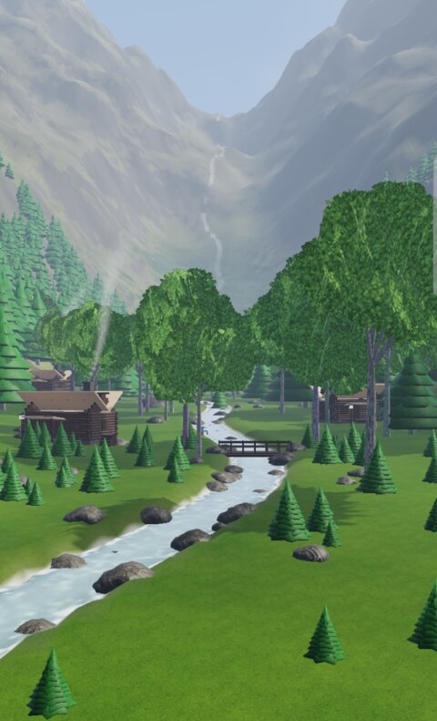
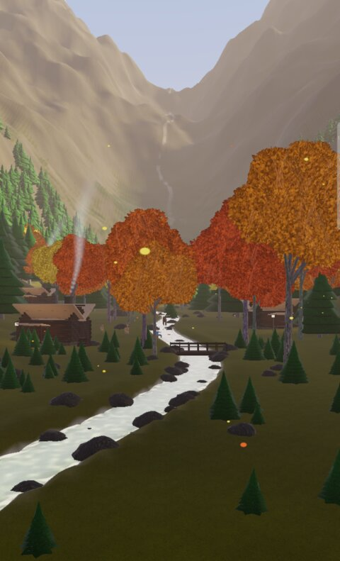
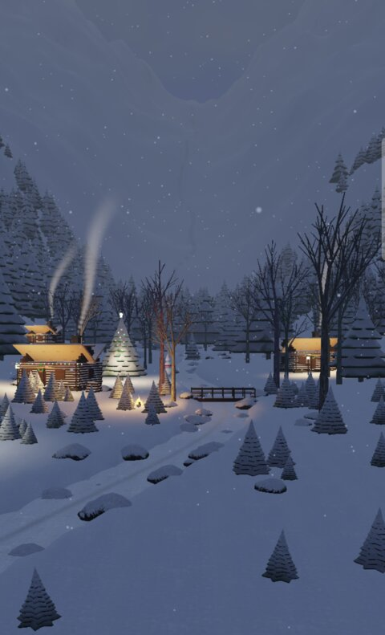
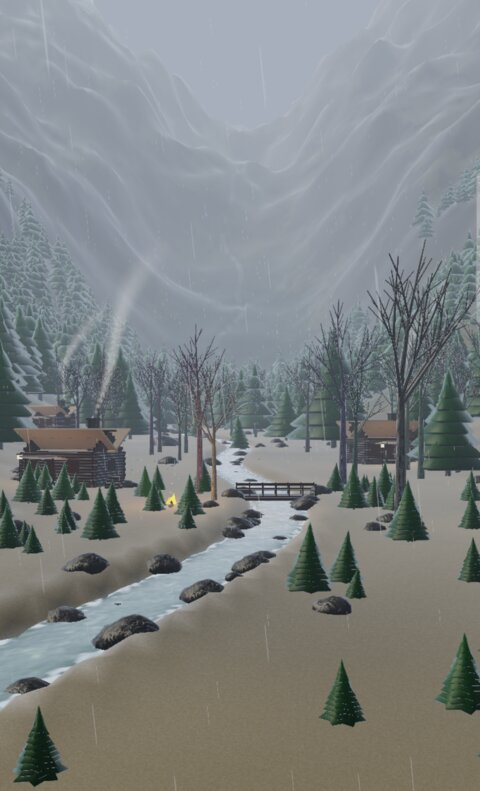
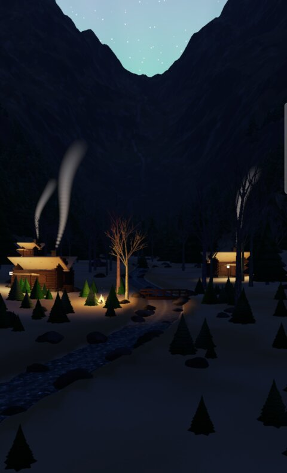

# Open Live Wallpaper

A photoreal, fully real-time 3D live wallpaper for Android: a snowy-to-green Québec valley with log cabins, a flowing stream
and a spruce forest. It follows the **real weather, time, moon, seasons and holidays** of Montréal (or another city).
No clock is drawn: this is a wallpaper, not a clock app.

| Summer | Autumn | Winter / Christmas | Spring rain / Easter | Night / Carnaval |
|---|---|---|---|---|
|  |  |  |  |  |

## What it does
- **Vulkan renderer** written in C++ (NDK): procedural terrain, instanced spruce and maple forest, log cabins, a stream with
  foam, ice and snow, sun shadow map, PBR-textured materials from CC0 photo textures, atmospheric sky with
  clouds, stars, real moon phase, aurora borealis, fog and lightning. Rendered at a reduced internal resolution and upscaled,
  30 fps by default (60 fps option), paused when the screen is off.
- **Real conditions**: live weather from [Open-Meteo](https://open-meteo.com) (clouds, rain, snow, fog, wind, thunder, snow depth,
  temperature), sun and moon positions computed on the device, so the lighting follows the real hour of the chosen city.
- **Seasons from the date**: snow cover and frozen stream in winter, melt and mud in spring, green foliage in summer,
  red and orange maples with falling leaves in autumn.
- **Living scene**: chimney smoke, lit windows and lanterns at night, a campfire, deer, moose, a fox, a loon, geese in a V,
  fireflies, a fisherman, skaters on the rink and a skier.
- **Events by date**: Christmas, New Year (fireworks), Valentine, Carnaval (Bonhomme and ice palace), St Patrick, sugar shack season,
  Easter, Fête nationale du Québec (flags, bonfire, fireworks), Canada Day, Halloween and Thanksgiving.
- **Preview mode** in the app: force the season, the time of day, a time-lapse, the weather, any event or the aurora.
- Home-screen scroll shifts the camera slightly. No gyroscope, no sound, no location permission.

## Install
Download `OpenLiveWallpaper-1.0.0.apk` from the [Releases](https://github.com/LinuxKernel44/OpenLiveWallpaperForAndroid/releases) page,
install it, open the app and press **Set as wallpaper**. Requires Android 10 or newer (API 29), an arm64 device and Vulkan 1.1.

## Build
Needs JDK 17+, the Android SDK (platform 37), NDK 27.0.12077973 and CMake 3.22.1.

```bash
./gradlew :app:assembleDebug
```

Signed release build (the keystore stays outside the repo):

```bash
KEYSTORE_FILE=/path/olw.jks KEYSTORE_PASSWORD=... KEY_ALIAS=olw KEY_PASSWORD=... ./gradlew :app:assembleRelease
```

Shaders are precompiled to SPIR-V; after editing a `.vert` or `.frag` file run `tools/compile_shaders.sh` (uses the NDK `glslc`).

## Quality settings
Auto picks High on devices with 11 GB of RAM or more and Medium otherwise. Low renders at 50% resolution, Medium at 65%,
High at 85% with 4x MSAA. Tested on a Galaxy S10 (Mali-G76, 30 fps in Medium).

## Credits
See [CREDITS.md](CREDITS.md). Textures: ambientCG (CC0). Weather: Open-Meteo. License: MIT.
